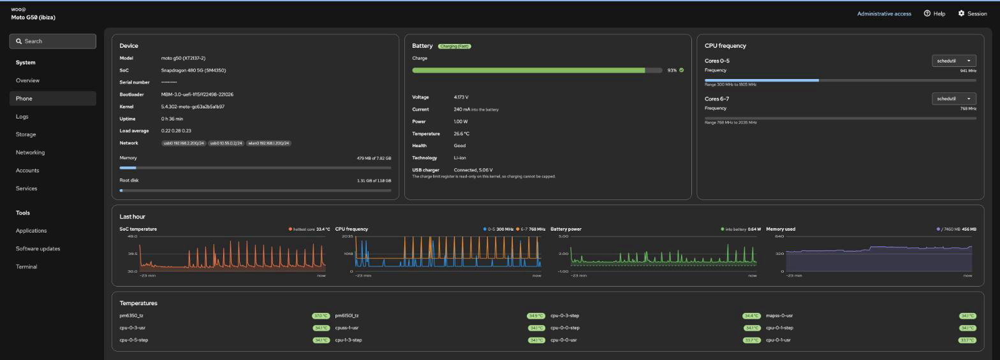

# linux-ibiza: Debian 13 on a Moto G50 (XT2137-2, SM4350 "holi", codename ibiza)

Debian 13 (trixie, arm64) running on a Motorola Moto G50 with the stock bootloader and the vendor 5.4 kernel. There is no
mainline kernel and no replacement bootloader, and the Qualcomm hypervisor stays in place. The phone boots straight into
Debian when you press the power button. WiFi, Bluetooth and a Cockpit web page for managing the phone all work.

Android is gone from the tested unit. The Debian root filesystem lives on the old `userdata` partition (about 103 GB of ext4),
the boot image is flashed to `boot_a`, and `super` is kept because WiFi needs Android's `system` and `vendor` files.

## Status

| Feature | State | Notes |
|---|---|---|
| Boot Debian 13 (systemd 257) | works | boot image in `boot_a`; `fastboot boot` also works for testing |
| USB gadget networking and serial | works | NCM + ACM; static `192.168.2.200` (Mac Internet Sharing subnet) and `10.55.0.2` |
| WiFi (WCN3990 via icnss2 and `wlan.ko`) | works | needs the modem plus Android's `pm-service` and `cnss-daemon` in a chroot (see below) |
| Bluetooth (same chip, UART `ttyHS0`) | partly | firmware loads from userspace behind a pty proxy; scanning works, pairing and audio are untested |
| `ibiza.local`, Cockpit | works | avahi, and a custom Phone page built with PatternFly 6 |
| Regulatory domain | works | `regulatory.db` is packed into the initramfs |
| KVM | impossible | the Qualcomm hypervisor owns EL2 (`All CPU(s) started at EL1`) |
| Display, touch, GPU, audio, camera, cellular | untested | the screen of the tested unit is broken; the modem is booted (WiFi needs it) but cellular is unused |

## The Cockpit Phone page



Live values come from sysfs. A small service (`phone-setup/ibiza-history.*`) samples temperature, CPU frequency, battery power
and memory every 5 seconds and keeps the last hour for the charts.

## How it works

```
power on, or: fastboot boot boot.img
  stage 1 initramfs (boot/init, busybox): USB gadget, /dev built from /sys (the kernel has no devtmpfs)
    mounts the partition named userdata (ext4) and pivots into it, then starts systemd
      NetworkManager (usb0 static, wlan0), avahi, cockpit
      ibiza-wifi.service       wifi/wifi_stack.sh        modem, Android helpers, wlan.ko
      ibiza-bluetooth.service  bluetooth/bt_boot.sh      WCN3990 bring-up
      ibiza-lockdown.service   kills leftover stage-1 debug servers
```

If `userdata` does not hold a Debian root, stage 1 falls back to an ext4 image inside `super`. If that fails too, it stays in
stage 1 with a telnet shell on USB. Those debug services are never started on a normal boot.

What took the longest to find (evidence is in [`docs/HANDOFF.md`](docs/HANDOFF.md)):

* systemd needs `/dev` to be a mount point. The kernel has no `CONFIG_DEVTMPFS`, and without a mount point systemd freezes
  silently. Stage 1 mounts a tmpfs on the new root's `/dev` and fills it from `/sys/class/*`.
* The WiFi firmware runs inside the modem, in a protection domain that fetches `wlanmdsp.mbn` over TFTP. So the modem has to
  boot (`/dev/subsys_modem`, restart level `RELATED`), with `qrtr`, `pd-mapper`, `tqftpserv` and `rmtfs` registered before the
  modem link comes up, because the downstream kernel drops userspace QRTR registrations made afterwards. `rmtfs` works on
  copies of the EFS partitions, never the real ones.
* `cnss-daemon` (sends board data and calibration) and `pm-service` are bionic binaries. They run from the read-only
  `system_a` and `vendor_a` plus the runtime APEX, in an overlayfs chroot. `wifi/ibizaprop/propshim.c` is a small `LD_PRELOAD`
  that stands in for the missing property service and SELinux calls; without it libbinder loops forever in
  `WaitForPropertyCreation`. The board data file `bdwlan_ibiza_ipa.bin` must be visible at `/vendor/firmware_mnt/image`.
* Bluetooth died seconds after the firmware download for four independent reasons. The host UART runtime-suspends when idle.
  Closing the tty drops RTS and the chip sleeps. The kernel's `hci_qca` sends a 243-byte first TLV segment that kills the
  chip's parser, while a 16-byte first segment works. The chip also shares power rails with WiFi, so power-cycling it does
  nothing. A resident perl process keeps the tty open and exposes a pty for `btattach`.
* Other kernel quirks: no IPC, PID or USER namespaces (Cockpit units need `PrivateIPC=no` and similar), no debugfs, and
  `wlan.ko` is built with `PANIC_ON_BUG`, so never `rmmod wlan` after a failed load.

## Layout

| Directory | Contents |
|---|---|
| `boot/` | stage-1 `init` and `build_stage1.py`, which builds the boot image from your `boot.img` kernel plus busybox plus `init` |
| `rootfs/` | Debian 13 rootfs build (`debootstrap` in a native arm64 VM), configuration, self-check, ext4 image |
| `wifi/` | `wifi_stack.sh`, the Android chroot, the property and SELinux shim, a logd stand-in, EFS copy |
| `bluetooth/` | WCN3990 bring-up and the pty proxy |
| `net/` | NetworkManager, avahi and usb0 setup |
| `phone-setup/` | Cockpit identity (fake DMI, CPU model name), LEDs, history sampler, lockdown, systemd drop-ins |
| `cockpit/` | the Phone page (React 18, PatternFly 6, esbuild) |
| `tools/` | ssh helpers, pstore grabber, throughput server, `mark_boot_successful.py` |
| `dsu/` | boot Debian from Android through a Dynamic System Update image; needs a working Android, so it is historical now |
| `flash/` | the original LineageOS, Magisk and GApps flashing helpers (historical) |
| `docs/` | `HANDOFF.md` (the full engineering log) and a draft wiki page for the device |

## What you have to supply

Nothing proprietary is committed. From your own phone you need the LineageOS `boot.img` (for the kernel), the `modem_a` and
`bluetooth_a` partition contents (firmware), `vendor_a` and `system_a` (read from `super`), `btpower.ko` and `wlan.ko` from
`/vendor/lib/modules`, and Debian packages from deb.debian.org. Cockpit's `pkg/lib` comes from
<https://github.com/cockpit-project/cockpit> at commit `92e0108d` (see `cockpit/deploy.sh` and the HANDOFF).

The kernel source for the running binary is
[LineageOS/android_kernel_motorola_sm6375](https://github.com/LineageOS/android_kernel_motorola_sm6375), commit `c63a2b5a1b97`
(Linux 5.4.302, GPL-2.0).

## Warnings

* Never resize or add entries to the GPT of the UFS LUN that holds `super` and `userdata`, and do not use sgdisk on it. The
  bootloader then reads nothing from that LUN (`cid` and `imei` come back empty, `fastboot boot` fails with "No Media") and
  Android cannot boot. The fix is `fastboot flash partition gpt.bin` with the file from the stock firmware package.
* With no Android to mark the boot as successful, the slot's retry counter drops on every boot and the slot is eventually
  declared unbootable. Run `tools/mark_boot_successful.py /dev/sdd apply` on the phone, and run it again after every
  `fastboot flash boot_a`, which resets the attributes.
* The modem touches the EFS partitions (`modemst1`, `modemst2`, `fsg`, `fsc`: IMEI and RF calibration). Back them up and keep
  `rmtfs` on copies (`wifi/efs_copy.sh`). The packaged `rmtfs.service` uses `-P` (the real partitions), so mask it.
* `rootfs/configure_rootfs.sh` locks the root password unless you pass `ROOT_PW`. Add your ssh key to
  `/root/.ssh/authorized_keys` and create a normal sudo user for Cockpit. `phone-setup/10-ibiza-hardening.conf` sets
  `PermitRootLogin prohibit-password`.
* This is research code for one device. Flashing or booting images can brick hardware, so read the scripts first.

## Licence

The Cockpit page under `cockpit/` carries AGPL-3.0-or-later headers (its structure follows
[ezy_speech_cockpit](https://github.com/gahingwoo/ezy_speech_cockpit) and Cockpit's starter-kit). The rest has no licence file yet.
